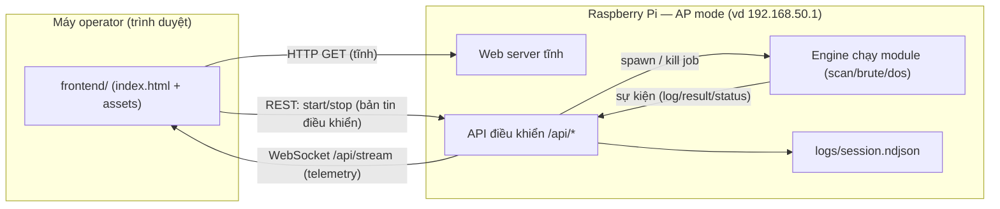
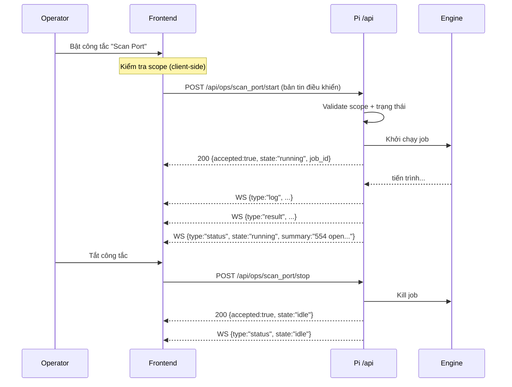
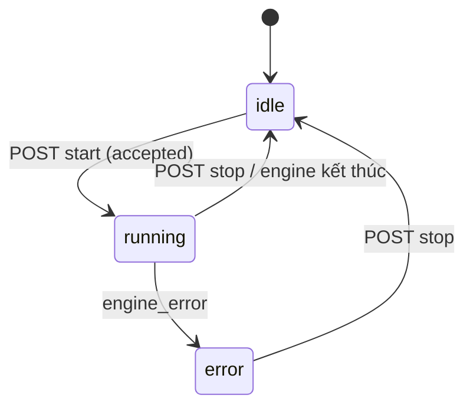

# WEB.MD — Luồng chạy & Giao thức điều khiển (Frontend ⇄ Raspberry Pi)

Tài liệu hợp đồng giữa **frontend** (web console trong `frontend/`) và **backend**
(chạy trên Raspberry Pi). Đây là nguồn sự thật duy nhất cho các bản tin điều khiển.
Mọi thay đổi tên endpoint / tên field phải cập nhật tại đây **trước**, rồi báo cho hai phía.

- Phiên bản hợp đồng: **v1**
- Mã hoá: `application/json`, UTF-8
- Tên field: `snake_case`
- Định danh module: `scan_ip`, `scan_port`, `brute`, `dos`

> ⚠️ **Phạm vi sử dụng.** Công cụ phục vụ kiểm thử **được ủy quyền trong mạng lab nội bộ**
> (engagement `VQEC-RT-01`). Backend **bắt buộc** chặn mục tiêu ngoài RFC1918 cho các
> module tấn công (`brute`, `dos`) — xem [§7 Scope](#7-ràng-buộc-phạm-vi-scope).

---

## 1. Kiến trúc tổng quan

Raspberry Pi phát Wi-Fi ở chế độ **AP (Access Point)**. Máy của operator (laptop/điện thoại)
nối vào SSID của Pi, mở trình duyệt tới IP của Pi. Pi vừa **phục vụ web tĩnh**, vừa chạy
**API điều khiển** + **kênh telemetry**.



Vì web được phục vụ ngay từ Pi nên frontend dùng đường dẫn **same-origin** (`/api`,
`/api/stream`) — không cần CORS, không hard-code IP của AP.

**Hai kênh truyền:**

| Kênh | Hướng | Giao thức | Dùng cho |
|---|---|---|---|
| Điều khiển | Client → Pi | HTTP REST (POST/GET) | Bật/tắt module, đọc trạng thái |
| Telemetry | Pi → Client | WebSocket `/api/stream` | Log, kết quả, cập nhật trạng thái real-time |

---

## 2. Vòng đời một thao tác (bật → chạy → tắt)



Nếu `/api/health` không phản hồi, frontend tự chuyển sang **chế độ MOCK**: UI hoạt động đầy
đủ với dữ liệu giả lập (để demo/dev khi backend chưa sẵn sàng). Chip ở góc phải hiện
`Mock (chưa có backend)`.

---

## 3. Bản tin điều khiển (Client → Pi)

### 3.1. Envelope chung

Mọi lệnh `start`/`stop` gửi lên đều theo khuôn:

```json
{
  "request_id": "f3a1c2e8-...",   // UUID, để đối soát/idempotency
  "ts": 1731312000,               // epoch giây (client)
  "engagement": "VQEC-RT-01",     // định danh đợt kiểm thử
  "module": "scan_port",          // scan_ip | scan_port | brute | dos
  "action": "start",              // start | stop
  "params": { }                   // tham số (xem §4)
}
```

### 3.2. Endpoints

| Method | Path | Mục đích | Body |
|---|---|---|---|
| `GET`  | `/api/health` | Kiểm tra backend sống | — |
| `GET`  | `/api/status` | Snapshot trạng thái 4 module | — |
| `POST` | `/api/ops/{module}/start` | Bật 1 module | Envelope `action:"start"` |
| `POST` | `/api/ops/{module}/stop`  | Tắt 1 module | Envelope `action:"stop"` |
| `POST` | `/api/ops/stop_all` | Tắt tất cả (nút dừng khẩn) | `{request_id, ts}` |

`{module}` ∈ `scan_ip | scan_port | brute | dos`.

### 3.3. Phản hồi

**Thành công:**
```json
{
  "request_id": "f3a1c2e8-...",
  "accepted": true,
  "module": "scan_port",
  "state": "running",      // idle | running | error
  "job_id": "job-7b12"
}
```

**Từ chối / lỗi** (HTTP 4xx/409, hoặc 200 với `accepted:false`):
```json
{
  "request_id": "f3a1c2e8-...",
  "accepted": false,
  "module": "dos",
  "error": { "code": "out_of_scope", "message": "Mục tiêu 8.8.8.8 ngoài RFC1918" }
}
```

### 3.4. Bảng mã lỗi

| `code` | Ý nghĩa | Gợi ý xử lý ở frontend |
|---|---|---|
| `out_of_scope` | Mục tiêu không thuộc RFC1918 (module tấn công) | Khóa DoS, báo đỏ |
| `invalid_target` | IP/CIDR sai định dạng | Hiện lỗi ô nhập |
| `busy` | Module đang chạy / tài nguyên bận | Giữ trạng thái hiện tại |
| `requires_root` | Thiếu quyền (SYN/ICMP raw) | Log cảnh báo |
| `engine_error` | Lỗi nội bộ engine | Log lỗi |

---

## 4. Tham số từng module (`params`)

Frontend chỉ thu thập **2 ô nhập**: `scan_range` (dải quét) và `target` (IP nạn nhân).
Mọi tham số kỹ thuật khác dùng **mặc định phía backend** (không lộ ra UI theo yêu cầu demo).

| Module | `params` gửi lên | Mặc định backend đề xuất |
|---|---|---|
| `scan_ip`   | `{ "scan_range": "192.168.1.0/24" }` | TCP/ARP ping, timeout 0.5s, phân giải vendor |
| `scan_port` | `{ "target": "192.168.1.30" }` | top-1000 cổng, TCP connect, nhận diện banner |
| `brute`     | `{ "target": "192.168.1.30" }` | dịch vụ tự phát hiện (SSH/RTSP/HTTP), wordlist mặc định, dừng khi thấy |
| `dos`       | `{ "target": "192.168.1.30" }` | connection-exhaustion + tùy chọn SYN/ICMP/UDP flood (cấu hình ở backend) |

> Ghi chú: cả hai field `scan_range` và `target` luôn được gửi kèm để backend có đủ ngữ cảnh;
> module chỉ dùng field liên quan tới nó.

---

## 5. Telemetry (Pi → Client qua WebSocket `/api/stream`)

Pi đẩy các bản tin JSON rời rạc. Frontend phân loại theo `type`.

### 5.1. `log` — dòng nhật ký
```json
{ "type": "log", "ts": 1731312001, "module": "scan_port",
  "level": "info", "text": "tcp connect 192.168.1.30 top-1000" }
```
`level` ∈ `info | ok | warn | error`.

### 5.2. `result` — kết quả có cấu trúc
```json
{ "type": "result", "ts": 1731312004, "module": "scan_port",
  "data": { "open_ports": [
    { "port": 554, "proto": "rtsp", "service": "RTSP" },
    { "port": 80,  "proto": "http", "service": "nginx 1.24" }
  ] } }
```
Gợi ý `data` theo module:
- `scan_ip`  → `{ "hosts": [ { "ip", "hostname", "mac", "vendor", "rtt_ms" } ] }`
- `scan_port`→ `{ "open_ports": [ { "port", "proto", "service", "version" } ] }`
- `brute`    → `{ "found": [ { "service", "username", "password" } ], "tried": 318 }`
- `dos`      → `{ "sent": 4512, "pps": 300, "target_state": "up|degraded|unavailable", "rtt_ms": 480 }`

### 5.3. `status` — đổi trạng thái / tóm tắt hiển thị trên tile
```json
{ "type": "status", "ts": 1731312007, "module": "dos",
  "state": "running", "summary": "RTSP UNAVAILABLE" }
```

Frontend map: `status.summary` → dòng chữ nhỏ trên tile; `status.state:"idle"` → tắt tile.

---

## 6. Máy trạng thái của module



`GET /api/status` trả snapshot để frontend đồng bộ lại sau khi reload trang:
```json
{
  "engagement": "VQEC-RT-01",
  "modules": {
    "scan_ip":   { "state": "idle" },
    "scan_port": { "state": "running", "since": 1731312000, "summary": "554 open..." },
    "brute":     { "state": "idle" },
    "dos":       { "state": "idle" }
  },
  "config": { "scan_range": "192.168.1.0/24", "target": "192.168.1.30" }
}
```

---

## 7. Ràng buộc phạm vi (Scope)

- Frontend chặn **DoS** khi `target` không thuộc RFC1918 (`10/8`, `172.16/12`, `192.168/16`).
  Đây **chỉ là guard UX** — không được coi là lớp bảo vệ.
- **Backend BẮT BUỘC kiểm tra lại** scope cho `brute` và `dos`, trả `out_of_scope` nếu vi phạm,
  bất kể client gửi gì. Đây là lớp chặn thật.
- Khuyến nghị: backend giữ **allowlist** dải lab trong cấu hình (vd `scope.yaml`) và từ chối
  mọi mục tiêu ngoài danh sách.

---

## 8. Checklist cho backend (Raspberry Pi)

- [ ] Phục vụ `frontend/` tĩnh (nginx hoặc chính app) tại `/`.
- [ ] `GET /api/health` → `{ "status": "ok", "version": "1.0", "uptime_s": 123 }`.
- [ ] `GET /api/status` → snapshot như §6.
- [ ] `POST /api/ops/{module}/start|stop` → đúng envelope §3, **idempotent theo `request_id`**.
- [ ] WebSocket `/api/stream` đẩy `log/result/status` như §5.
- [ ] Validate scope server-side (§7); ghi mọi lệnh ra `logs/session.ndjson` (1 JSON/dòng).
- [ ] `stop_all` kill sạch mọi job (nút dừng khẩn).

**Ví dụ `curl` test nhanh:**
```bash
curl -s localhost/api/health
curl -s -X POST localhost/api/ops/scan_ip/start \
  -H 'Content-Type: application/json' \
  -d '{"request_id":"t1","ts":0,"engagement":"VQEC-RT-01","module":"scan_ip","action":"start","params":{"scan_range":"192.168.1.0/24"}}'
```

---

## 9. Mock mode (khi chưa có backend)

Frontend hiện chạy được độc lập: nếu `/api/health` fail trong `healthTimeoutMs` (1.5s),
nó dùng `MockClient` (`frontend/assets/js/api.js`) phát sự kiện giả lập theo kịch bản.
Khi backend lên, **không cần sửa frontend** — chỉ cần `/api/health` trả 200 là tự chuyển `live`.
